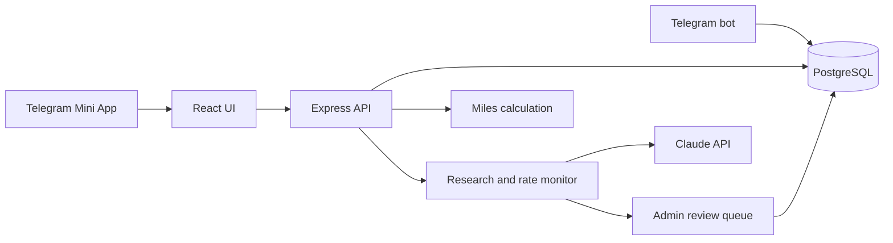

# Miles Tracker

A Telegram Mini App prototype for tracking Singapore credit-card miles. It records spending, estimates earned miles and remaining bonus-rate caps, and ranks a user's cards for a planned purchase. An AI-assisted research flow proposes new card definitions, while a separate rate monitor proposes changes for administrator review.

This is an implemented **prototype**, not a deployed financial service. The card catalog is seed data from the development period and may be outdated. Verify card terms with the issuing bank before relying on a result. AI-extracted rates are suggestions: users review new-card drafts, and only an administrator can approve monitored changes. New rate types require manual catalog review because the current change record does not contain enough structured detail to add them safely.

## What is implemented

- React Mini App pages for a dashboard, transaction logging, card wallet, and recommendations.
- Express API with Telegram `initData` signature checks in production and per-user ownership checks.
- PostgreSQL/Prisma persistence for users, cards, earning rates, transactions, and review history.
- A calculation engine for rate matching, rounding, bonus caps, and ranked recommendations, with unit tests.
- Telegram bot commands and an administrator review queue.
- Claude-assisted card research and rate monitoring. These integrations require an API key and have not been validated against current bank terms for this showcase.

The app has **no hosted demo or production deployment**. The architecture and setup below describe the code in this repository.



## Run locally

Requirements: Node.js, npm, Docker, and a PostgreSQL container. Copy `.env.example` to `.env`. The example uses local-only database credentials and leaves the Telegram and Claude tokens blank so the browser prototype can start without external services.

```sh
npm ci
cp .env.example .env
make setup
npm run dev:backend
```

In another terminal:

```sh
npm run dev:frontend
```

Open `http://127.0.0.1:5173`. The Vite frontend proxies `/api` to the backend at port 3000. Development mode injects a fixed local test user when Telegram `initData` is absent; the backend listens on `127.0.0.1` by default. Do not expose that development service to a network. The Docker database created by `make setup` also binds only to loopback.

For a production deployment, set `NODE_ENV=production`, a real `TELEGRAM_BOT_TOKEN`, `ADMIN_TELEGRAM_ID`, database credentials, and allowed origins. Set `HOST=0.0.0.0` only behind the intended ingress. Production routes require signed Telegram `initData`; `/health` is available without it. Deployment and live card-rate verification remain to be done.

## Verify the code

```sh
npm run build
npm test -w packages/backend
```

`npm run build` generates the Prisma client before compiling the backend. The current test suite covers the calculation engine, administrator authorization, and signed Telegram timestamp checks. It does not exercise a live Telegram client, Claude API, or production database.

The eligibility review adds regression cases for merchant exclusions, unmet minimum spending, explicitly excluded rates, exhausted caps, `FOREIGN_ASEAN` fallback, empty catalogs, and cap overflow. Selection and overflow use the same eligibility checks. When no earning rule applies, the engine returns zero earnings with no applied rate and an explicit explanation; it does not resurrect an ineligible rate as a fallback. The reviewed change passes 38 tests and the full build.

## Design notes

- Card research stores a draft after user confirmation. Drafts remain inactive; an administrator activation workflow is still to be built.
- The rate monitor compares suggested values to stored rates and queues differences. Approvals and rejections are restricted to `ADMIN_TELEGRAM_ID` and recorded with the verified Telegram ID. A suggestion that cannot be matched to exactly one existing rate stays pending for manual review.
- The calculation engine works from card rules and recorded spending. Current cap tracking conservatively counts all logged spend on a card against each capped rate because transactions do not yet store the rate they used. This can understate remaining bonus capacity and affect rankings. The engine also cannot account for every bank exclusion, reward-point conversion, settlement-date rule, or promotional term.
- [WORKSHOP.md](WORKSHOP.md) records the development history and ideas. Its card figures and planned deployment sections are historical notes, not current bank guidance or a claim that deployment is complete.

## Future development roadmap

| Priority | Potential | Next deliverable | Completion evidence |
| --- | --- | --- | --- |
| P0 | Correct cap accounting | Persist the applied rule and bonus/base allocation for each transaction, with explicit shared-cap buckets and billing/calendar-period definitions. Define a migration policy for older transactions that lack this information. | Database-backed tests showing unrelated spend does not consume an ineligible rate's cap, including edits, refunds, partial-cap transactions, and legacy records. |
| P1 | Reliable AI-assisted catalog research | Evaluate structured extraction against a labelled set of synthetic or licensed public examples. Record source URLs, retrieval dates, and review decisions; flag uncertain or unmatched terms instead of silently guessing. | Field-level extraction accuracy, unsupported-term/error counts, source provenance, and a review queue tested with fake API responses. Live card terms require a separate bank-source verification. |
| P1 | Complete draft activation | Give administrators a validated, auditable route to approve, edit, reject, and activate new-card drafts without bypassing catalog constraints. | Authorization, conflicting-review, transaction rollback, and concurrent approval tests using a test database. |
| P2 | Explainable recommendations | Show the selected rule, exclusions, rounding, cap allocation, catalog verification date, and unavailable-rule states alongside an estimate. | Scenario tests covering the explanation and computed result together; stale or unsupported terms remain explicit. |
| P2 | Integration and deployment evidence | Add isolated PostgreSQL integration tests, Telegram session tests, CI, and documented production configuration. Keep the development test-user bypass restricted to local use. | Repeatable end-to-end tests with synthetic data and a separately verified production deployment; no real customer or banking credentials in test artifacts. |

**Next milestone:** finish the cap-allocation ledger and its migration/integration tests before expanding recommendations or deploying for real users. The AI workflow remains a proposal-and-review system.
